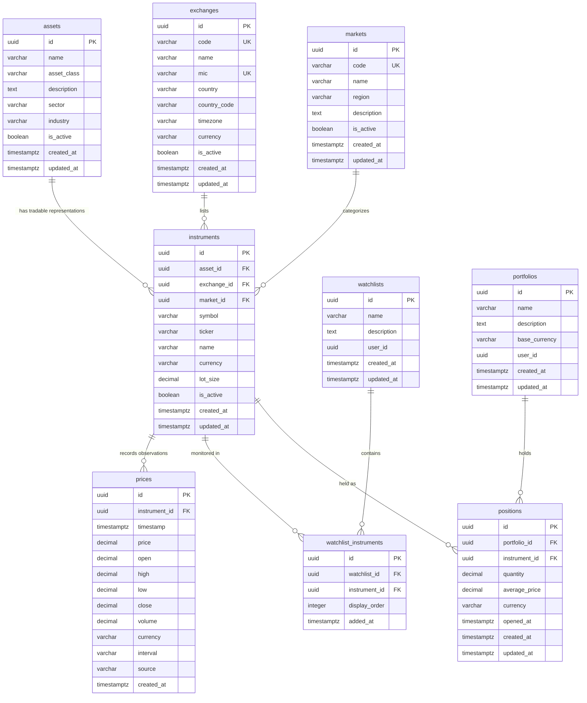

# CentFlow Initial Data Model

## 1. Overview & Purpose

This document defines the initial persistence-oriented data model for CentFlow.

It translates the conceptual domain model defined in [`docs/domain-model.md`](domain-model.md) into concrete entity structures, fields, primary identifiers, relationships, data types, and integrity constraints.

This data model serves as the foundational contract for:
- Database architecture and migrations (Phase 2, Issue #16)
- Backend repositories and service models (Phase 2, Issue #14)
- API request/response schemas (Phase 2, Issue #15)
- Ingested and normalized market data persistence (Phase 3)
- Quantitative analytics and market intelligence metrics (Phase 4)

---

## 2. Design Principles & Data Conventions

The initial data model adheres to the following conventions:

1. **Surrogate Primary Keys:** Every entity uses a standard UUID v4 (`id`) as its primary key. This prevents sequence hotspotting, decouples internal references from external provider identifiers, and simplifies distributed generation.
2. **Natural & Composite Unique Constraints:** In addition to surrogate UUIDs, business entities enforce uniqueness constraints to prevent duplicate records (e.g., `(exchange_id, symbol)` on instruments, `mic` on exchanges).
3. **Naming Conventions:**
   - Table names are lower-case snake_case plurals: `assets`, `instruments`, `exchanges`, `markets`, `prices`, `watchlists`, `watchlist_instruments`, `portfolios`, `positions`.
   - Column names are lower-case snake_case: `asset_id`, `created_at`, `average_price`.
   - Foreign keys use the singular referenced table name followed by `_id`: `asset_id`, `exchange_id`, `portfolio_id`.
4. **Monetary & Numeric Precision:**
   - All prices, average prices, and financial values use exact fixed-point decimals (`DECIMAL(18, 6)`).
   - Asset quantities (allowing for whole shares, fractional equities, and crypto holdings) use `DECIMAL(18, 8)`.
   - Floating-point representations (`FLOAT`, `DOUBLE`) are strictly avoided for financial figures to eliminate rounding inaccuracies.
5. **Standardized Currencies:** Currencies are stored as 3-character uppercase ISO 4217 strings (`USD`, `EUR`, `INR`, `GBP`).
6. **Timezone-Aware Timestamps:**
   - All timestamps are stored in UTC (`TIMESTAMPTZ` / ISO 8601 string representation).
   - Stateful entities contain audit fields: `created_at` (immutable) and `updated_at` (modified on state changes).
7. **Referential Integrity & Cascading:**
   - Dependent child records in join tables (`watchlist_instruments`, `positions`) cascade on deletion of their parent container (`watchlists`, `portfolios`).
   - Core reference entities (`assets`, `instruments`, `exchanges`) restrict deletion when child records reference them.

---

## 3. Core Persistence Entities

### 3.1 `assets`

Represents the underlying financial or economic entity being tracked, independent of a specific exchange or trading venue.

| Field | Type | Nullable | Default | Description |
| :--- | :--- | :--- | :--- | :--- |
| `id` | UUID | No | `gen_random_uuid()` | Primary Key |
| `name` | VARCHAR(255) | No | — | Asset name (e.g., "Apple Inc.", "Bitcoin") |
| `asset_class` | VARCHAR(50) | No | — | Asset category (`equity`, `currency`, `commodity`, `crypto`, `index`) |
| `description` | TEXT | Yes | `NULL` | Informational summary of the asset |
| `sector` | VARCHAR(100) | Yes | `NULL` | Economic sector (e.g., "Technology") |
| `industry` | VARCHAR(100) | Yes | `NULL` | Industry classification (e.g., "Consumer Electronics") |
| `is_active` | BOOLEAN | No | `TRUE` | Whether the asset is currently active |
| `created_at` | TIMESTAMPTZ | No | `NOW()` | Record creation timestamp (UTC) |
| `updated_at` | TIMESTAMPTZ | No | `NOW()` | Record update timestamp (UTC) |

---

### 3.2 `exchanges`

Represents a trading venue or marketplace where instruments are listed and traded.

| Field | Type | Nullable | Default | Description |
| :--- | :--- | :--- | :--- | :--- |
| `id` | UUID | No | `gen_random_uuid()` | Primary Key |
| `code` | VARCHAR(20) | No | — | Unique internal exchange code (e.g., "NASDAQ", "NSE") |
| `name` | VARCHAR(255) | No | — | Full exchange name |
| `mic` | VARCHAR(10) | Yes | `NULL` | ISO 10383 Market Identifier Code (e.g., "XNAS", "XNSE") |
| `country` | VARCHAR(100) | Yes | `NULL` | Country of operation (e.g., "United States", "India") |
| `country_code` | VARCHAR(2) | Yes | `NULL` | ISO 3166-1 alpha-2 code (e.g., "US", "IN") |
| `timezone` | VARCHAR(50) | Yes | `NULL` | IANA timezone identifier (e.g., "America/New_York") |
| `currency` | VARCHAR(3) | Yes | `NULL` | Primary settlement currency (e.g., "USD", "INR") |
| `is_active` | BOOLEAN | No | `TRUE` | Operational status of the exchange |
| `created_at` | TIMESTAMPTZ | No | `NOW()` | Record creation timestamp (UTC) |
| `updated_at` | TIMESTAMPTZ | No | `NOW()` | Record update timestamp (UTC) |

**Constraints:**
- `UNIQUE(code)`
- `UNIQUE(mic)` where `mic IS NOT NULL`

---

### 3.3 `markets`

Represents a logical market or market grouping (geographic, regional, asset-class, or regulatory segment).

| Field | Type | Nullable | Default | Description |
| :--- | :--- | :--- | :--- | :--- |
| `id` | UUID | No | `gen_random_uuid()` | Primary Key |
| `code` | VARCHAR(50) | No | — | Unique market code (e.g., "US_EQUITIES", "GLOBAL_CRYPTO") |
| `name` | VARCHAR(255) | No | — | Descriptive name (e.g., "US Equities Market") |
| `region` | VARCHAR(100) | Yes | `NULL` | Region grouping (e.g., "North America", "Global") |
| `description` | TEXT | Yes | `NULL` | Description of the logical market |
| `is_active` | BOOLEAN | No | `TRUE` | Market tracking status |
| `created_at` | TIMESTAMPTZ | No | `NOW()` | Record creation timestamp (UTC) |
| `updated_at` | TIMESTAMPTZ | No | `NOW()` | Record update timestamp (UTC) |

**Constraints:**
- `UNIQUE(code)`

---

### 3.4 `instruments`

Represents a specific, tradable financial security associated with an underlying Asset and optionally tied to an Exchange and Market.

| Field | Type | Nullable | Default | Description |
| :--- | :--- | :--- | :--- | :--- |
| `id` | UUID | No | `gen_random_uuid()` | Primary Key |
| `asset_id` | UUID | No | — | Foreign Key → `assets(id)` (RESTRICT) |
| `exchange_id` | UUID | Yes | `NULL` | Foreign Key → `exchanges(id)` (RESTRICT) |
| `market_id` | UUID | Yes | `NULL` | Foreign Key → `markets(id)` (SET NULL) |
| `symbol` | VARCHAR(50) | No | — | Trading symbol (e.g., "AAPL", "MSFT", "RELIANCE") |
| `ticker` | VARCHAR(50) | Yes | `NULL` | Exchange-specific ticker code if distinct from symbol |
| `name` | VARCHAR(255) | No | — | Instrument description (e.g., "Apple Inc. Common Stock") |
| `currency` | VARCHAR(3) | No | — | Quotation currency (e.g., "USD", "INR") |
| `lot_size` | DECIMAL(18, 4) | No | `1.0` | Minimum trade lot unit |
| `is_active` | BOOLEAN | No | `TRUE` | Whether the instrument is actively quoted/traded |
| `created_at` | TIMESTAMPTZ | No | `NOW()` | Record creation timestamp (UTC) |
| `updated_at` | TIMESTAMPTZ | No | `NOW()` | Record update timestamp (UTC) |

**Constraints:**
- `UNIQUE(exchange_id, symbol)` — An exchange cannot have duplicate symbols.

---

### 3.5 `prices`

Represents time-series market data observations for an Instrument. Designed to support both discrete point-in-time ticks and aggregated historical bar intervals (OHLCV).

| Field | Type | Nullable | Default | Description |
| :--- | :--- | :--- | :--- | :--- |
| `id` | UUID | No | `gen_random_uuid()` | Primary Key |
| `instrument_id` | UUID | No | — | Foreign Key → `instruments(id)` (CASCADE) |
| `timestamp` | TIMESTAMPTZ | No | — | Observation or bar close timestamp (UTC) |
| `price` | DECIMAL(18, 6) | No | — | Observed price or close value |
| `open` | DECIMAL(18, 6) | Yes | `NULL` | Bar open price (for OHLCV bars) |
| `high` | DECIMAL(18, 6) | Yes | `NULL` | Bar highest price |
| `low` | DECIMAL(18, 6) | Yes | `NULL` | Bar lowest price |
| `close` | DECIMAL(18, 6) | Yes | `NULL` | Bar closing price |
| `volume` | DECIMAL(24, 4) | Yes | `NULL` | Trading volume during interval |
| `currency` | VARCHAR(3) | No | — | Observation currency |
| `interval` | VARCHAR(20) | No | `'tick'` | Interval resolution (`tick`, `1m`, `5m`, `1h`, `1d`) |
| `source` | VARCHAR(50) | Yes | `NULL` | Provider source tag (e.g., "manual", "alpha_vantage") |
| `created_at` | TIMESTAMPTZ | No | `NOW()` | Ingestion timestamp (UTC) |

**Indexes & Performance Considerations:**
- `CREATE INDEX idx_prices_instrument_timestamp ON prices (instrument_id, timestamp DESC);`
- `CREATE INDEX idx_prices_interval_lookup ON prices (instrument_id, interval, timestamp DESC);`
- `UNIQUE(instrument_id, interval, timestamp, source)` to guarantee deduplication during repeated ingestion cycles.

---

### 3.6 `watchlists`

Represents a user-defined collection of instruments monitored together.

| Field | Type | Nullable | Default | Description |
| :--- | :--- | :--- | :--- | :--- |
| `id` | UUID | No | `gen_random_uuid()` | Primary Key |
| `name` | VARCHAR(100) | No | — | User-defined watchlist name (e.g., "Tech Equities") |
| `description` | TEXT | Yes | `NULL` | Optional watchlist notes |
| `user_id` | UUID | Yes | `NULL` | Future multi-user owner reference |
| `created_at` | TIMESTAMPTZ | No | `NOW()` | Creation timestamp (UTC) |
| `updated_at` | TIMESTAMPTZ | No | `NOW()` | Last updated timestamp (UTC) |

---

### 3.7 `watchlist_instruments`

Associative join table modeling the many-to-many relationship between `watchlists` and `instruments`.

| Field | Type | Nullable | Default | Description |
| :--- | :--- | :--- | :--- | :--- |
| `id` | UUID | No | `gen_random_uuid()` | Primary Key |
| `watchlist_id` | UUID | No | — | Foreign Key → `watchlists(id)` (CASCADE) |
| `instrument_id` | UUID | No | — | Foreign Key → `instruments(id)` (CASCADE) |
| `display_order` | INTEGER | No | `0` | Order of display in user interface |
| `added_at` | TIMESTAMPTZ | No | `NOW()` | Time when instrument was added to the watchlist |

**Constraints:**
- `UNIQUE(watchlist_id, instrument_id)` — An instrument can appear at most once per watchlist.

---

### 3.8 `portfolios`

Represents a managed collection of financial positions.

| Field | Type | Nullable | Default | Description |
| :--- | :--- | :--- | :--- | :--- |
| `id` | UUID | No | `gen_random_uuid()` | Primary Key |
| `name` | VARCHAR(100) | No | — | Portfolio name (e.g., "Long-Term Growth") |
| `description` | TEXT | Yes | `NULL` | Optional portfolio description |
| `base_currency` | VARCHAR(3) | No | `'USD'` | Valuation and reporting currency |
| `user_id` | UUID | Yes | `NULL` | Future multi-user owner reference |
| `created_at` | TIMESTAMPTZ | No | `NOW()` | Creation timestamp (UTC) |
| `updated_at` | TIMESTAMPTZ | No | `NOW()` | Last updated timestamp (UTC) |

---

### 3.9 `positions`

Represents a specific holding of an Instrument within a Portfolio.

| Field | Type | Nullable | Default | Description |
| :--- | :--- | :--- | :--- | :--- |
| `id` | UUID | No | `gen_random_uuid()` | Primary Key |
| `portfolio_id` | UUID | No | — | Foreign Key → `portfolios(id)` (CASCADE) |
| `instrument_id` | UUID | No | — | Foreign Key → `instruments(id)` (RESTRICT) |
| `quantity` | DECIMAL(18, 8) | No | — | Number of units held (>0 for long, <0 for short) |
| `average_price` | DECIMAL(18, 6) | No | — | Weighted average acquisition price per unit |
| `currency` | VARCHAR(3) | No | — | Currency denomination of average price |
| `opened_at` | TIMESTAMPTZ | Yes | `NULL` | Timestamp when the position was first opened |
| `created_at` | TIMESTAMPTZ | No | `NOW()` | Creation timestamp (UTC) |
| `updated_at` | TIMESTAMPTZ | No | `NOW()` | Last modification timestamp (UTC) |

**Constraints:**
- `UNIQUE(portfolio_id, instrument_id)` — Net position per instrument per portfolio.

---

## 4. Entity Relationship Diagram (ERD)

---

## 5. Extensibility & Future Phase Alignment

The data model is deliberately engineered to remain extensible without requiring breaking schema redesigns in subsequent phases:

1. **Market Data Engine (Phase 3):**
   - The `prices` table accommodates continuous tick streams (`interval = 'tick'`) and aggregate interval bars (`1m`, `5m`, `1d`) with OHLCV data.
   - The `source` column tracks external data providers (e.g., Alpha Vantage, Yahoo Finance, Polygon, Binance) enabling multi-provider normalization and data quality audits.
2. **Analytics & Technical Indicators (Phase 4):**
   - Time-series analytics (Returns, Volatility, Moving Averages, RSI, MACD) compute directly off `prices(instrument_id, timestamp)` without altering master entity definitions.
   - Future calculated metric tables can cleanly reference `instrument_id` and specific time windows.
3. **Product Experience (Phase 5):**
   - `watchlists` and `watchlist_instruments` provide the backing structure for custom user monitoring and ordering.
   - `portfolios` and `positions` provide the necessary fields for holdings management, valuation tracking, and portfolio performance calculations.
   - `user_id` fields are present as nullable references, ensuring zero migration friction when authentication and multi-tenancy are introduced.

---

## 6. Next Steps

With the initial data model established, the project progression moves to:
1. **Issue #14 — Establish backend application architecture:** Structure service, API, repository, and core configuration boundaries in FastAPI.
2. **Issue #15 — Establish API conventions:** Define request/response formats, validation patterns, error handling, and serialization models.
3. **Issue #16 — Establish database foundation:** Select and configure the persistence layer (engine, ORM, migrations, and repository implementations) matching this data model specification.
